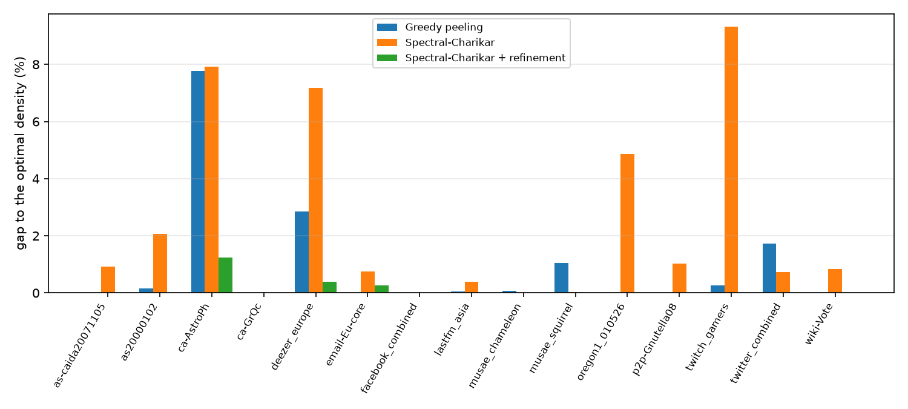
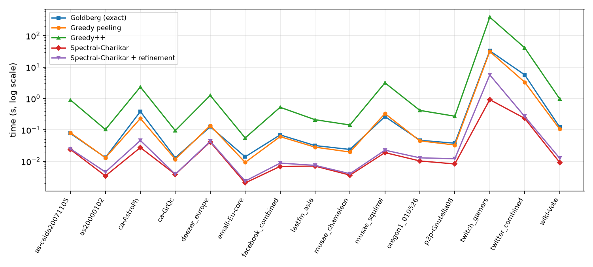

# Spectral densest subgraph

**Finding the densest part of a large graph with one eigenvector instead of a max-flow or a linear program.**

The densest subgraph of a graph is the set of nodes S that maximizes the average degree of the subgraph it induces, d(S) = |E(S)| / |S|. It can be found exactly with max-flow (Goldberg, 1984) or with a linear program (Charikar, 2000), and approximated within a factor 1/2 by greedy peeling. This repository implements **Spectral-Charikar**, the method proposed in my bachelor's thesis: Charikar's threshold rounding applied to the leading eigenvector of the adjacency matrix instead of the LP solution, followed by a local refinement. It is compared with two exact and two greedy algorithms on 15 SNAP graphs with up to 6.8 million edges.

## Author

- [Davide Cinelli](https://github.com/davidecinelli26)

Bachelor's thesis *Un algoritmo spettrale per l'estrazione di sottografi densi* (A spectral algorithm for dense subgraph extraction), B.Sc. in Computer Engineering, University of Calabria, A.Y. 2023/2024. Supervisor: Prof. Andrea Pugliese. Co-supervisor: Prof. Domenico Mandaglio. The code has since been rewritten and the experiments rerun on the original SNAP files: what changed is in [`CHANGES.md`](CHANGES.md).

## How it works

Charikar's LP gives every node a weight y_v:

```
maximize    Σ_e x_e
subject to  x_e ≤ y_u,  x_e ≤ y_v     for every edge e = (u, v)
            Σ_v y_v = 1,   x, y ≥ 0
```

Its optimal value is the maximum density, and one of the threshold sets {v : y_v ≥ r} of an optimal solution is a densest subgraph. Spectral-Charikar keeps the rounding and replaces y with the leading eigenvector u of the adjacency matrix A. The eigenvector maximizes the Rayleigh quotient xᵀAx / xᵀx, which on the indicator vector of a set S equals 2 d(S): it is the densest subgraph problem relaxed to real-valued vectors, and its large entries mark where the dense part of the graph is.

1. **Eigenvector.** |u| from the Lanczos solver (`scipy.sparse.linalg.eigsh`), which only needs sparse matrix-vector products, O(m) each.
2. **Sweep.** Nodes are sorted by |u| and every threshold set is a prefix of that order. An edge enters the prefix together with its later endpoint, so one cumulative sum gives |E| of all n prefixes at once: O(m + n log n) for all thresholds.
3. **Refinement.** While some node outside S has more than d(S) neighbours in S, or some node in S has fewer, the one with the largest margin is moved. Every move strictly increases the density. This is the "refinement technique" the thesis left as future work.

| Algorithm | Module | Guarantee |
|---|---|---|
| Goldberg's max-flow, on the ⌈d⌉-core of the greedy bound d, with Dinkelbach updates | [`exact.py`](src/densest/exact.py) | exact |
| Charikar's LP (HiGHS), on the same core | [`exact.py`](src/densest/exact.py) | exact |
| Greedy peeling (Charikar, 2000) | [`greedy.py`](src/densest/greedy.py) | ≥ 1/2 of the optimum |
| Greedy++ (Boob et al., 2020), ⌊ln n⌋ passes | [`greedy.py`](src/densest/greedy.py) | ≥ greedy peeling, converges to the optimum |
| **Spectral-Charikar** | [`spectral.py`](src/densest/spectral.py) | none |
| **Spectral-Charikar + refinement** | [`spectral.py`](src/densest/spectral.py) | ≥ Spectral-Charikar |

## Results

15 SNAP graphs, from 1,005 to 168,114 nodes and from 12,572 to 6.8 million edges, read as simple undirected graphs. Accuracy is the density found divided by the optimum computed by Goldberg's method, truncated so that 100% means the optimum. Times are wall-clock seconds on a laptop (AMD Ryzen 7 7735HS, 16 GB RAM, Python 3.11, SciPy 1.17), best of up to five runs for algorithms under one second. Full tables per graph: [`results/summary.md`](results/summary.md).

| Algorithm | Worst accuracy | Mean accuracy | Optimum found | vs greedy peeling (better / equal / worse) | Total time (s) |
|---|---:|---:|---:|---:|---:|
| Goldberg's max-flow (exact) | 100% | 100% | 15/15 | 10 / 5 / 0 | 39.8 |
| Charikar's LP (exact) | 100% | 100% | 13/15, 2 timeouts at 600 s | 8 / 5 / 0 | ≥ 1,574.2 |
| Greedy peeling | 92.23% | 99.06% | 5/15 | | 35.6 |
| Greedy++ | 99.73% | 99.96% | 11/15 | 10 / 5 / 0 | 437.9 |
| Spectral-Charikar | 90.69% | 97.59% | 3/15 | 3 / 2 / 10 | 1.3 |
| **Spectral-Charikar + refinement** | **98.75%** | **99.87%** | **9/15** | **8 / 5 / 2** | **6.1** |





### What the numbers say

- **Spectral-Charikar is the fastest algorithm on every graph**: 3 to 34 times faster than greedy peeling (6.5× in geometric mean) and 3 to 36 times faster than Goldberg's method.
- **The eigenvector alone is not enough.** Its threshold sets sit on the dense region but not exactly on the densest subgraph, so on its own Spectral-Charikar is less accurate than greedy peeling on 10 of the 15 graphs, down to 90.7% of the optimum on Twitch.
- **The refinement closes most of the gap at little cost.** Spectral-Charikar + refinement is never below 98.75% of the optimum, finds it on 9 graphs, beats greedy peeling on 8, ties on 5 and loses on 2 (by 0.26 points on email-Eu-core and 0.004 on wiki-Vote). It is still faster than greedy peeling on every graph: 2.7 to 15 times (4.8× in geometric mean).
- **Greedy++ is the most accurate approximation**, never below 99.73%, but it repeats the peeling ⌊ln n⌋ times and is 22 to 153 times slower than Spectral-Charikar + refinement.
- **On these graphs the exact optimum is affordable.** Restricted to the core, Goldberg's method solves the largest graph (6.8 million edges) in 33 s, about the time of one greedy peeling, which it runs for its lower bound. Charikar's LP is the slow exact method: it ran out of time on two graphs.

The times compare these Python implementations: the eigensolver, the max-flow and the LP run in compiled SciPy code, while the peeling of greedy and Greedy++ and the refinement moves are Python loops. A compiled greedy peeling would be closer to Spectral-Charikar.

### Compared with the thesis

The thesis concluded that Spectral-Charikar is faster than greedy peeling on average, at least as accurate on most graphs, and never below about 90% of the optimum. On the original data and with correct baselines, the first and the third point hold: it is the fastest algorithm on every graph, and its worst accuracy is 90.7%. The second does not: the greedy peeling of the thesis code stopped too early (see [`CHANGES.md`](CHANGES.md)), and correctly implemented it is more accurate than Spectral-Charikar on 10 of 15 graphs. The refinement suggested in the thesis' conclusions turns this around: with it, Spectral-Charikar is at least as accurate as greedy peeling on 13 of 15 graphs, and still faster on all of them.

## Quickstart

```bash
git clone https://github.com/davidecinelli26/spectral-densest-subgraph
cd spectral-densest-subgraph
pip install -e .
densest download                  # the 15 SNAP archives (53 MB), checked against SHA-256
densest solve twitter_combined    # Goldberg, greedy peeling and Spectral-Charikar + refinement
densest benchmark                 # every algorithm on every graph, resumable
densest report                    # results/summary.md and results/figures/
```

As a library, on any edge list:

```python
import numpy as np
from densest import Graph, goldberg, spectral_refined

u = np.array([0, 0, 0, 1, 1, 2, 3])  # a 4-clique on 0..3, plus the edge 3-4
v = np.array([1, 2, 3, 2, 3, 3, 4])
g = Graph.from_edges(u, v)  # node ids can be any integers; self-loops and duplicates are dropped

sol = spectral_refined(g)
print(sol.density, g.labels[sol.nodes])  # 1.5 [0 1 2 3]
print(goldberg(g).density)  # 1.5
```

Tests: `pip install -e ".[dev]"` and `pytest`. Every exact method is checked against brute force on random graphs, every approximation against its guarantee.

## Repository layout

```
src/densest/
├── graph.py        CSR graph, k-cores, threshold sweep
├── exact.py        core reduction, Goldberg's max-flow, Charikar's LP
├── greedy.py       greedy peeling, Greedy++
├── spectral.py     Spectral-Charikar, local refinement
├── datasets.py     the 15 SNAP graphs: URLs, checksums, parsers
├── benchmark.py    every algorithm on every graph, resumable
├── report.py       tables and figures
└── cli.py          the `densest` command
tests/              brute force on random graphs, guarantees, file formats
results/            benchmark.csv, summary.md, figures/
```

## References

- A. V. Goldberg. *Finding a maximum density subgraph*. Technical Report UCB/CSD-84-171, UC Berkeley, 1984.
- M. Charikar. *Greedy approximation algorithms for finding dense components in a graph*. APPROX 2000.
- D. Boob, Y. Gao, R. Peng, S. Sawlani, C. Tsourakakis, D. Wang, J. Wang. *Flowless: extracting densest subgraphs without flow computations*. WWW 2020.
- W. Feng, S. Liu, D. Koutra, H. Shen, X. Cheng. *SpecGreedy: unified dense subgraph detection*. ECML PKDD 2020.
- T. Lanciano, A. Miyauchi, A. Fazzone, F. Bonchi. *A survey on the densest subgraph problem and its variants*. ACM Computing Surveys, 2024.
- W. Dinkelbach. *On nonlinear fractional programming*. Management Science, 1967.
- J. Leskovec, A. Krevl. *SNAP Datasets: Stanford large network dataset collection*. http://snap.stanford.edu/data, 2014.

## License

[MIT](LICENSE)
